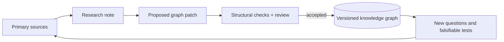

# Agentic Universe

**Evidence-led research and graph tooling for reliable, inspectable agentic systems.**

Agentic Universe studies how agent behavior changes across the model, harness, and multi-agent system—and how to evaluate those systems without confusing a plausible report with verified execution. The repository pairs a versioned research graph with small, auditable Python tools for graph and proposal validation.

> **Current snapshot · 2026-10-31:** 24 graph nodes · 21 directed edges · standard-library validation + unit tests

## What is here

- **A provenance-oriented knowledge graph** (`knowledge/graph/`): concepts, approaches, hypotheses, and explicit relationships. New research remains `to_test` until independently validated; cited papers are evidence for a claim, not automatic proof of it.
- **Graph quality tooling** (`tools/knowledge_graph.py`): checks required fields, unique IDs, confidence bounds, and edge endpoints; checks proposed graph patches before review.
- **A research update workflow** (`evolution/proposals/`, `research/`): source-linked findings are proposed first, reviewed with limitations, then applied to the graph.
- **A prototype human–LLM cycle** (`tools/human_llm_hybrid_cycle.py`): illustrative scaffold only. Its generation and evaluation functions are placeholders, not a live model integration.

## System map



The graph is the durable model; the research note and patch preserve the evidence and rationale for each proposed change. The workflow is human-reviewed—this repository does not autonomously promote claims.

## Quick start

Requires Python 3.11+; runtime tooling and tests use only the Python standard library.

```bash
# Validate the canonical graph
python tools/knowledge_graph.py validate

# Inspect its counts and categories
python tools/knowledge_graph.py summary

# Run the test suite
python -m unittest discover -s tests -v
```

GitHub Actions runs structural validation and unit tests on pushes and pull requests to `main`. Validate a new patch against the current graph with `check-proposal` before integrating it.

## Start here

| Read | Purpose |
| --- | --- |
| [`architecture/foundations.md`](architecture/foundations.md) | Core loop/graph model and design rules |
| [`knowledge/graph/agentic_universe_graph.json`](knowledge/graph/agentic_universe_graph.json) | Current curated graph |
| [`knowledge/graph/agentic_universe_schema.json`](knowledge/graph/agentic_universe_schema.json) | Graph schema |
| [`research/2026-10-31-agentic-reliability-evidence.md`](research/2026-10-31-agentic-reliability-evidence.md) | Latest cited research delta and caveats |
| [`evolution/proposals/2026-10-31-agent-evaluation-research-patch.json`](evolution/proposals/2026-10-31-agent-evaluation-research-patch.json) | Machine-checkable research update patch and evidence record |
| [`evolution/CHANGELOG.md`](evolution/CHANGELOG.md) | Accepted graph evolution history |

## Research posture

- **Separate evidence from interpretation.** Keep sources, derived claims, hypotheses, and implementation artifacts distinguishable.
- **Prefer falsifiable mechanisms.** A node should suggest what could be measured or disproved, not just name a topic.
- **Keep confidence calibrated.** A paper or author-reported benchmark result does not make the project's own claim `verified`.
- **Preserve counterevidence.** Relationships such as `challenges` keep disagreements visible instead of forcing premature consensus.

## Scope and limitations

This is an evolving research repository, not a production multi-agent runtime or a claim of general agent capability. The graph validator performs structural checks; it does not verify that cited papers support every interpretation. The October research note is an abstract-level focused review, and its new graph claims remain unreplicated. The human–LLM cycle script is a scaffold with placeholder functions.

No `LICENSE` file is currently included; reuse and redistribution permissions are therefore unspecified. Confirm licensing before reusing the material.

## Contributing

See [`CONTRIBUTING.md`](CONTRIBUTING.md). Research changes should include primary-source links, clear scope and limitations, a proposal patch, passing graph checks, and tests. Do not promote a hypothesis to a verified status based solely on a paper's reported result.
